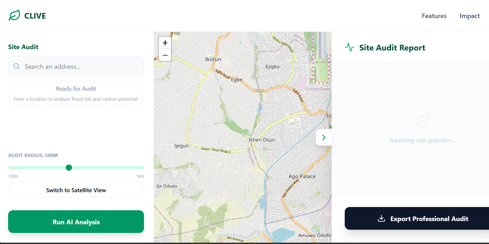

# 🌱 Clive

> Hyper-local climate planning for neighborhoods. Find where water runs, place nature-based solutions where they matter most, and quantify the carbon and cooling benefits.

🔗 **Live demo:** [clive-kappa.vercel.app](https://clive-kappa.vercel.app)

<!-- Add a screenshot or GIF here:-->



## About

Clive helps communities and planners make evidence-based climate decisions at the neighborhood scale. Using high-resolution terrain data, it identifies where runoff and flooding risks are concentrated, suggests where green infrastructure will have the biggest impact, and estimates the carbon and temperature benefits of that vegetation.

## Features

### 🌊 Flood Mitigation
Identify hyper-local runoff risks using high-resolution terrain data. Place bioswales precisely where they intercept the most water.

### 🌿 Active Carbon Sink
Quantify your neighborhood's carbon sequestration. High-efficiency vegetation offsets up to **0.31 kg C/m²/yr**.

### 🌡️ Cooling Effect
Estimate the local temperature reduction from added vegetation, around **2.5°C** of cooling.

<!-- Add or remove features to match the app exactly. -->

## How the Estimates Work

Sequestration and cooling figures are approximations based on published rates for high-efficiency vegetation. Real-world results vary with species, climate, soil, maturity, and maintenance, so treat outputs as planning estimates, not guarantees.

<!-- Document your data sources here, e.g.:
- Terrain data: (source, resolution)
- Sequestration rate: 0.31 kg C/m²/yr (source)
- Cooling effect: 2.5°C (source and conditions)
-->

## Tech Stack

- [React](https://react.dev/): UI
- [Vite](https://vite.dev/): build tool and dev server
- [Tailwind CSS](https://tailwindcss.com/): styling
- [ESLint](https://eslint.org/): linting
- [Vercel](https://vercel.com/): hosting

## Getting Started

### Prerequisites

- [Node.js](https://nodejs.org/) 18 or later
- npm

### Installation

```bash
git clone https://github.com/PontentialProgrammer/clive.git
cd clive
npm install
```

### Run locally

```bash
npm run dev
```

Open the URL Vite prints in your terminal (usually `http://localhost:5173`).

### Build for production

```bash
npm run build
npm run preview
```

### Lint

```bash
npm run lint
```

## Project Structure

```
clive/
├── public/            # Static assets
├── src/               # Application source code
├── index.html         # Entry HTML
├── tailwind.config.js # Tailwind configuration
├── vite.config.js     # Vite configuration
└── eslint.config.js   # ESLint configuration
```

## Roadmap

- [ ] Additional nature-based solutions (rain gardens, permeable surfaces, tree canopy)
- [ ] Support for more regions and terrain datasets
- [ ] Save and compare planning scenarios
- [ ] Export reports for community and municipal use

## Contributing

Contributions, issues, and feature requests are welcome. Feel free to open an issue or submit a pull request.

## License

Add a license (e.g. [MIT](https://choosealicense.com/licenses/mit/)) and reference it here.

## Author

Built by [PontentialProgrammer](https://github.com/PontentialProgrammer).
